<p align="center">
  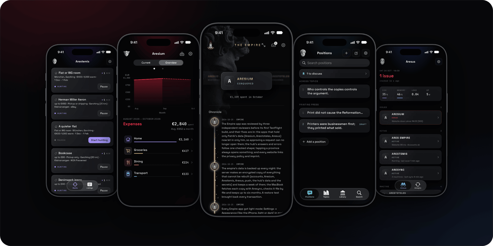
</p>

# The Ares iPhone apps

Five native iPhone apps on one shared account, written in SwiftUI. Each works in English and German, in light and
dark, and on made-up sample data for trying it without an account.
**[See them on patrikbreeck.com](https://patrikbreeck.com/en/apps/)**

<table>
  <tr>
    <td width="34%" valign="top">
      <h3>Aresium</h3>
      Personal finance from your bank's own exports: imported, sorted and counted on the iPhone, where the data stays.
      Widgets, receipts from a photo and a red mode.<br><br>
      Server and engine: <a href="https://github.com/Ares-Empire/aresium">aresium</a>
    </td>
    <td>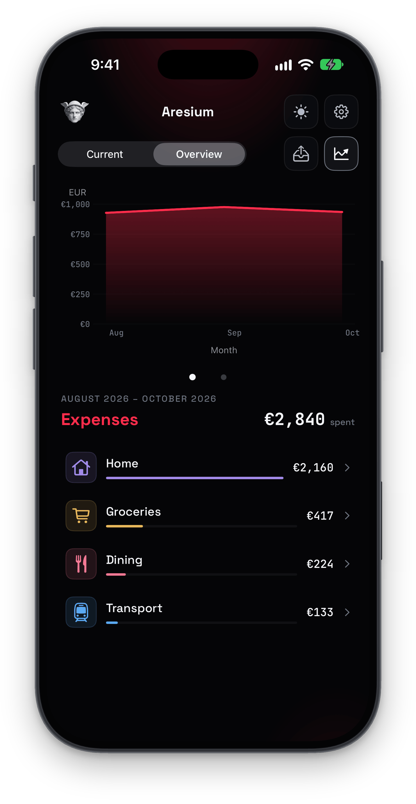</td>
    <td>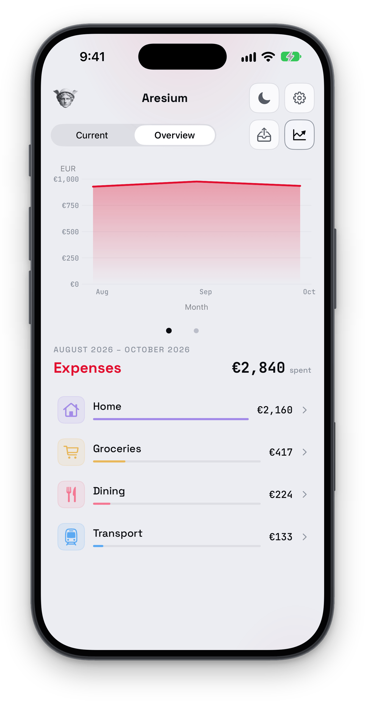</td>
    <td>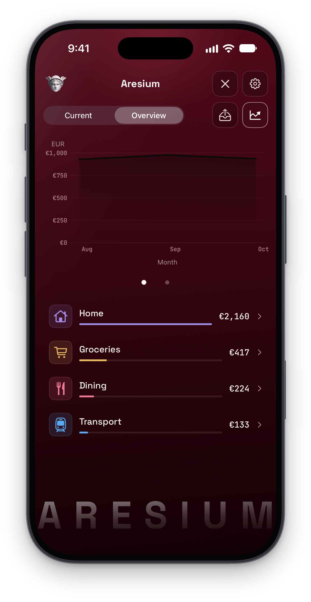</td>
  </tr>
  <tr>
    <td valign="top">
      <h3>Arestemis</h3>
      Searches that run for you: flats, things for sale, price monitors and page watches. New finds arrive as
      notifications, each with why it fits.
    </td>
    <td>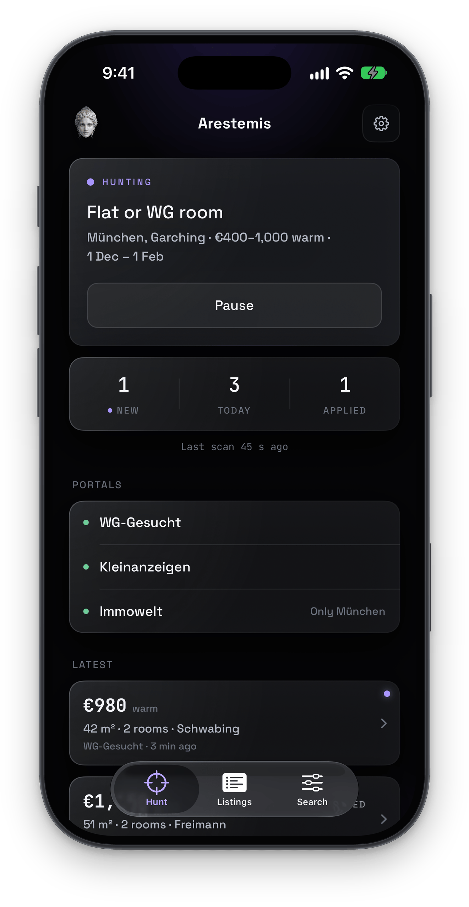</td>
    <td>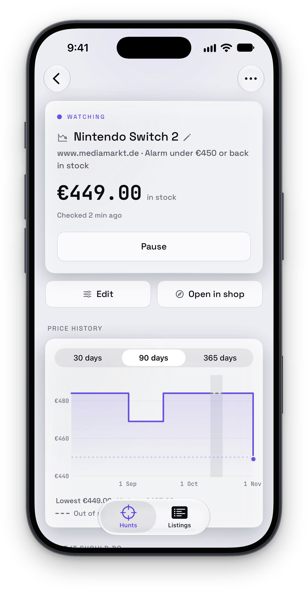</td>
    <td>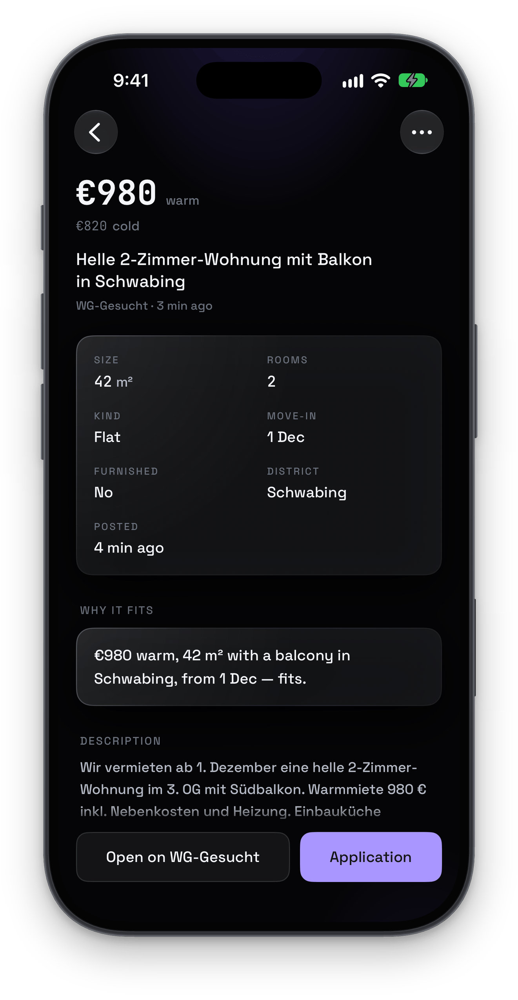</td>
  </tr>
  <tr>
    <td valign="top">
      <h3>Ares Empire</h3>
      The hub: every app of the account on a ring, the chronicle of what was built, access requests and approvals.<br><br>
      Server: <a href="https://github.com/Ares-Empire/ares-empire">ares-empire</a>
    </td>
    <td>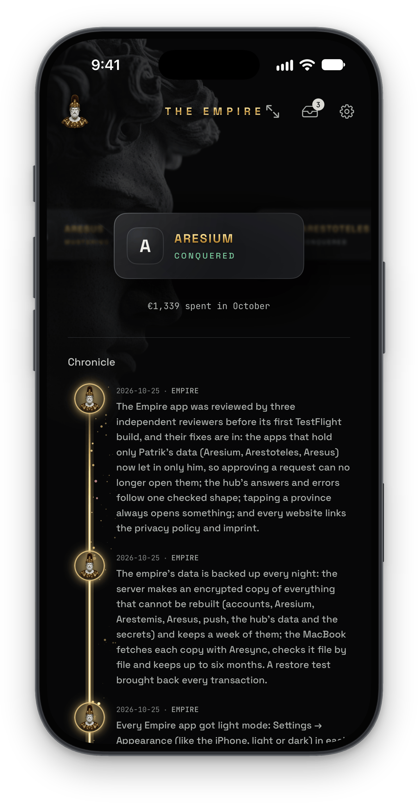</td>
    <td>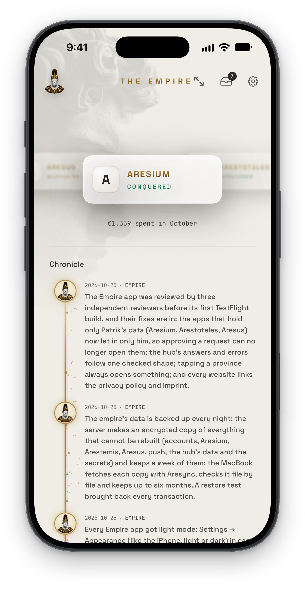</td>
    <td>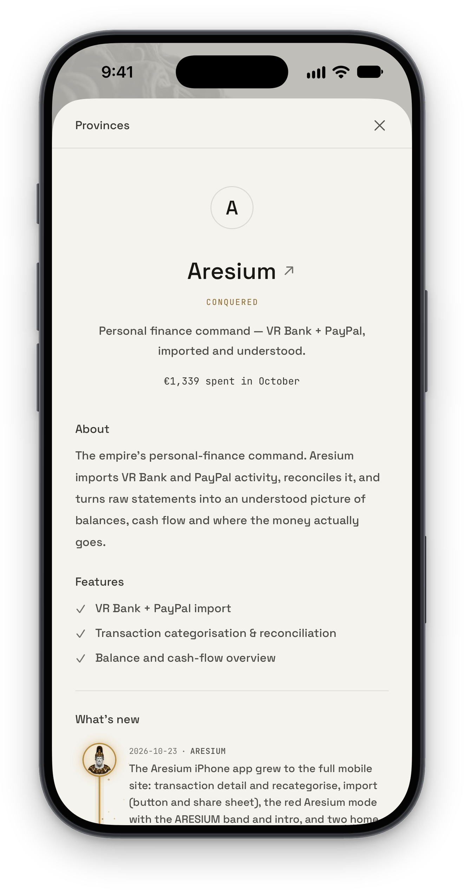</td>
  </tr>
  <tr>
    <td valign="top">
      <h3>Arestoteles</h3>
      A personal knowledge map: positions, topics and sources from an Obsidian vault, searched by meaning and edited on
      the phone.<br><br>
      Server: <a href="https://github.com/Ares-Empire/Arestoteles">Arestoteles</a>
    </td>
    <td>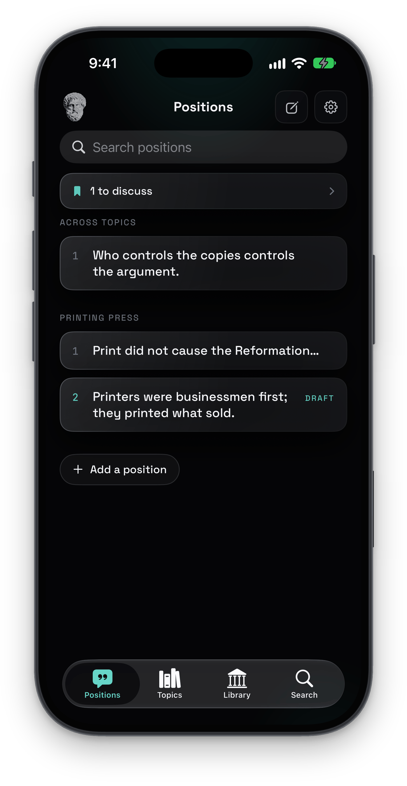</td>
    <td>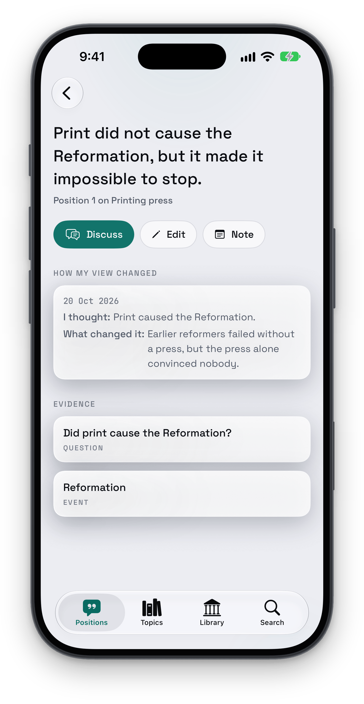</td>
    <td>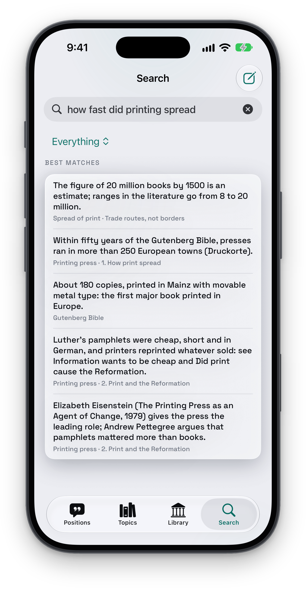</td>
  </tr>
  <tr>
    <td valign="top">
      <h3>Aresus</h3>
      The watchtower: the server and every service at a glance, each machine's sync runs, files sent from the iPhone
      to the Mac, and widgets for the home and lock screen.
    </td>
    <td>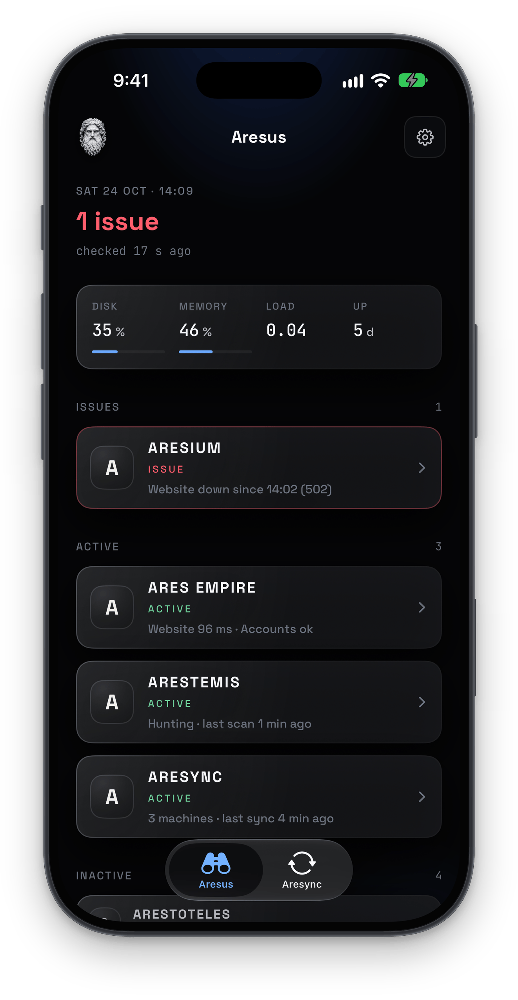</td>
    <td>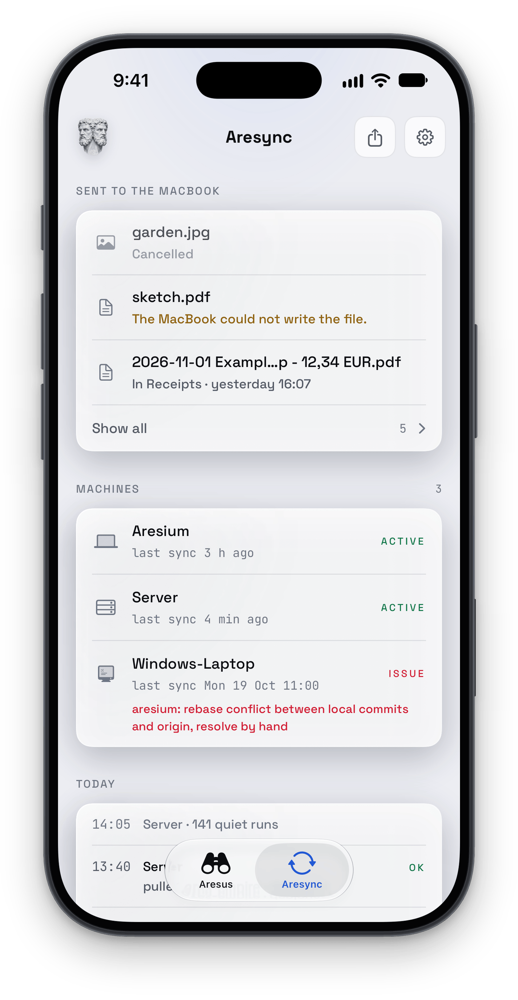</td>
    <td>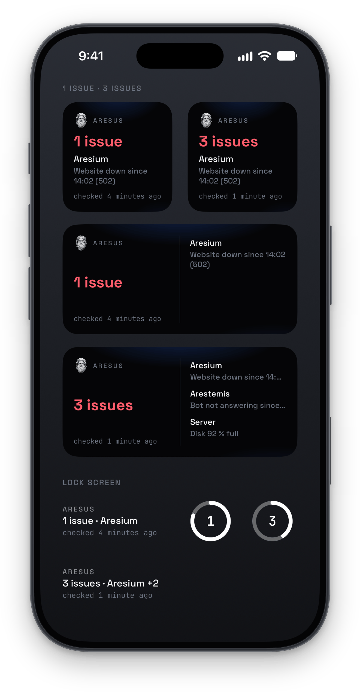</td>
  </tr>
</table>

More pictures with captions: [showcase/](showcase/README.md).

## Shared by every app

- **One account.** Logging in to one app logs in to all of them, through a shared Keychain group, and logging out
  ends it everywhere. Each app asks for its own access; accounts are created and run from inside any app.
- **Push.** One service on the server sends every app's notifications.
- **The same Settings.** Language, appearance, notifications, a contact form, the legal pages, the account.
- **Private when switching apps.** A cover hides the screen in the app switcher.

## How it's built

- SwiftUI for iOS 26 and later, with Apple's frameworks only (Swift Charts, SwiftData, WidgetKit, Vision,
  JavaScriptCore, Core Spotlight) and no third-party packages.
- One Xcode project per app. `Shared/` (login, network, push, settings, design) is compiled into every one of them.
- Each app talks to its own server's JSON API. Aresium also runs the server's TypeScript engine on the iPhone, in
  JavaScriptCore, so phone and server count alike.
- Every text lives in String Catalogs, in English and German.
- A sample mode (`-sampleData`) shows each app on made-up data with no server. `scripts/showcase.py` makes the
  pictures above from it.

## Run it

Open an app's project in Xcode 27 (for example `Aresium/Aresium.xcodeproj`), choose an iOS 26 simulator, and add
`-sampleData` to the scheme's launch arguments to look around without an account.

## Tests

GitHub runs all five apps' unit tests on every push and pull request, using Xcode 27.1 and an iPhone 17 on iOS 27.0.
The String Catalog check runs once too. On a Mac with that Xcode and runtime:

```sh
bash scripts/test-unit.sh --all
bash scripts/test-unit.sh Aresium Empire
bash scripts/test-unit.sh --timing Aresium
python3 scripts/strings.py check
```

The script creates and deletes its own simulator, keeps build output and result bundles in `build/test-unit/`, and
needs no Apple account. `--keep-simulator` keeps that simulator for inspection. Speed budgets and measurement suites
run only with `--timing`; correctness tests run by default. Different apps can run concurrently; two runs of the same
app cannot share its output directory.

On GitHub the workflow adds `--ci`, which also leaves out the six receipt tests that read the made-up receipt's code:
Vision's barcode detection finds nothing on GitHub's virtual Macs. They run on this Mac.

The shared-login probe (`scripts/check-shared-login.sh`), UI tests, AXe screen checks and device-only checks (Face ID,
push delivery, camera and rendering on a phone) stay manual. CI uploads no artifacts.

The layout, push and releasing to TestFlight: [docs/DEVELOPMENT.md](docs/DEVELOPMENT.md).
